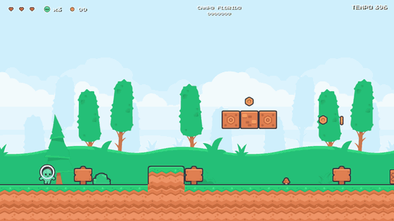
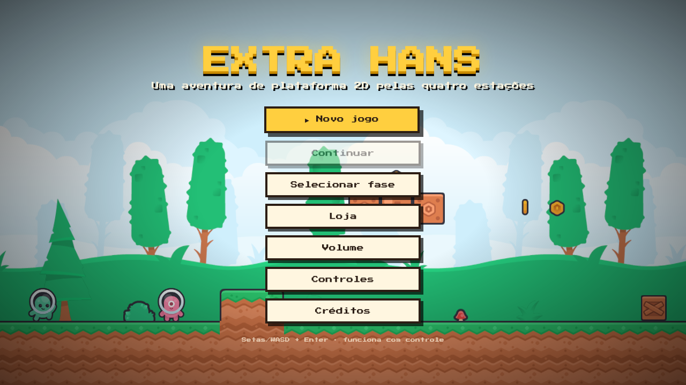
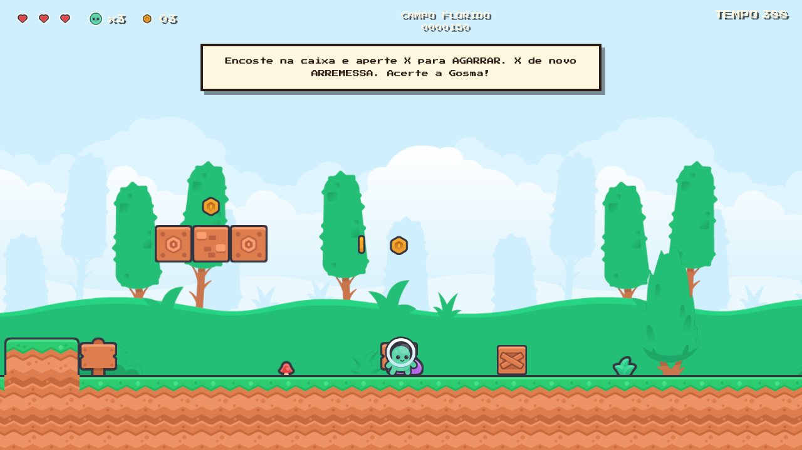
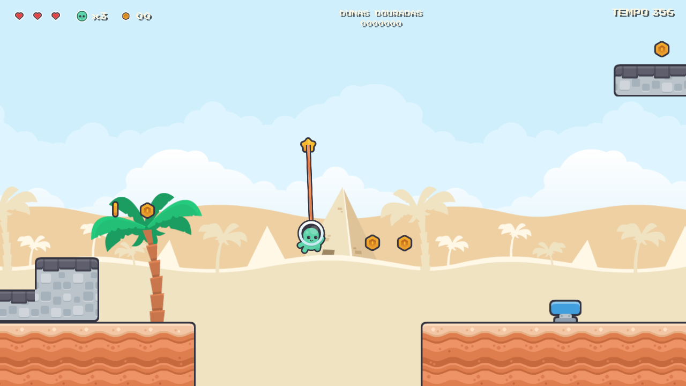
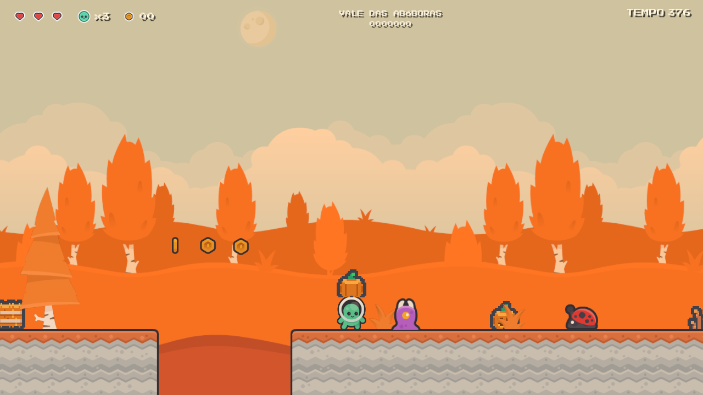
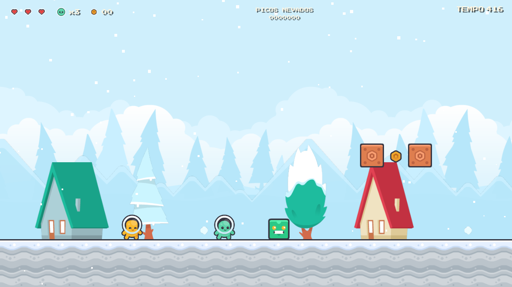
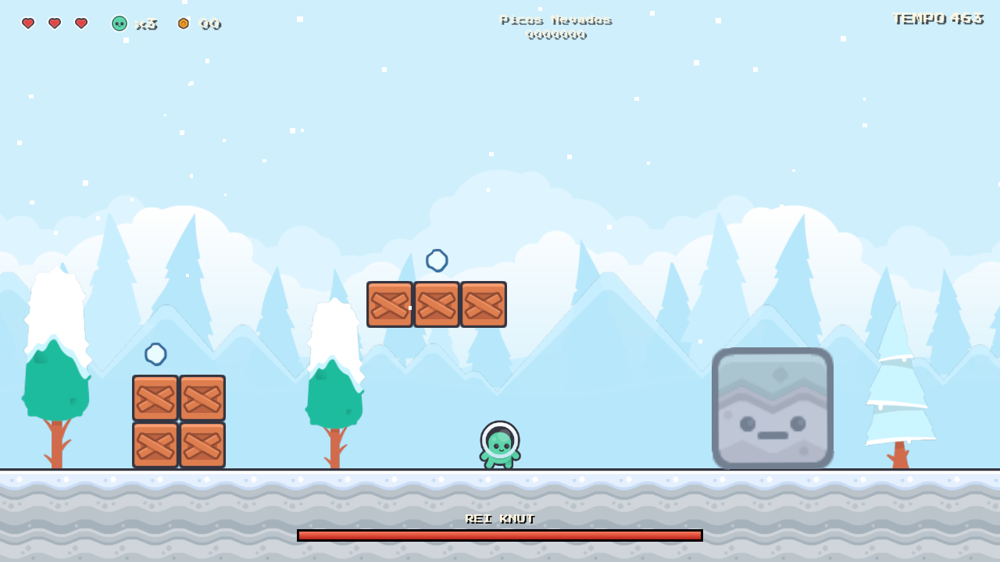
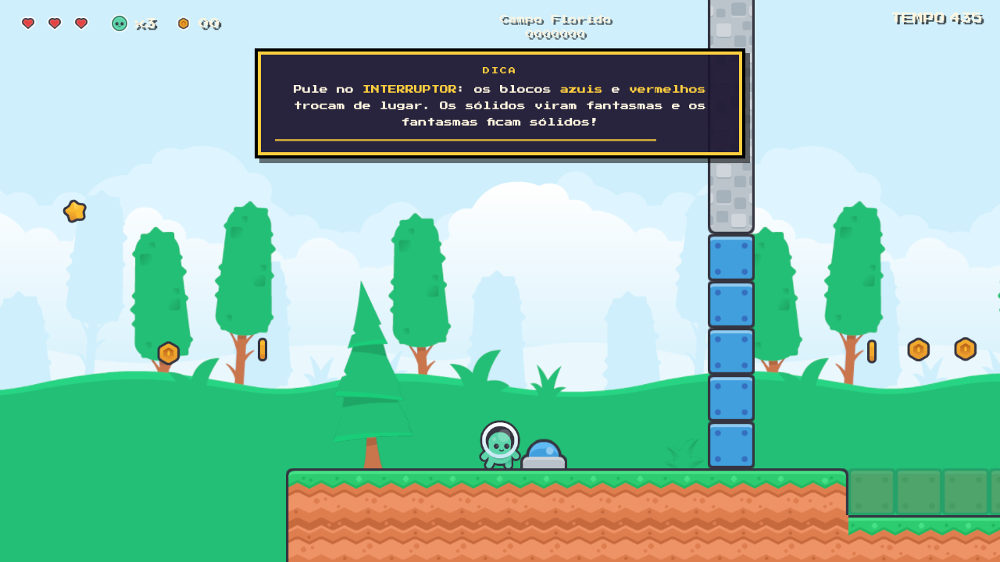
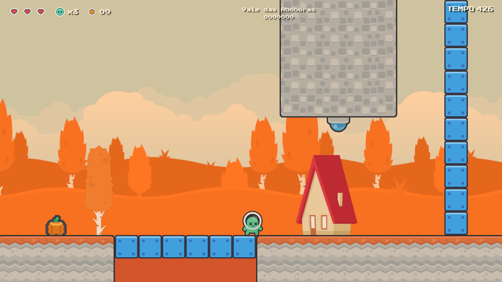

# 🚀 Extra Hans

Jogo de **plataforma 2D com tiles**, feito com **Three.js**, inspirado nos clássicos da SEGA como *Alex Kidd* e *Ristar*:
além de andar e pular, o herói **agarra e arremessa** objetos e inimigos, **balança em estrelas**, **escala** escadas e cordas e usa **molas** e **chaves**.
Cada fase mistura **quebra-cabeças** (interruptores que trocam blocos, portões que só abrem quando todos os monstros caem) com **desafios de timing** (pontes que somem depois de alguns segundos, inimigos que só ficam vulneráveis por um instante).



**▶ Jogar online:** https://desenvolvimento-de-jogos-final.vercel.app/

---

## 📖 História

No planeta Quatro-Estações, o **Relógio das Estações** faz a primavera virar verão, o verão virar outono e o outono virar inverno.
O **Rei Knut**, um bloco de gelo gigante e mal-humorado, roubou os quatro **Cristais das Estações** para deixar o planeta num inverno sem fim.

**Hans**, um pequeno astronauta que fez um pouso forçado no Campo Florido, descobre que os cristais também são a energia da sua nave.
Para voltar para casa (e salvar o planeta), ele precisa atravessar as quatro regiões e recuperar cada cristal.

### Como a história é contada
Não há diálogos obrigatórios: a história fica com os personagens espalhados pelas fases. Ao passar na frente de um deles aparece um balão com o **nome numa etiqueta colorida** e a fala ao lado; quem quiser ouvir mais aperta `↑`. O astronauta jogável não fala.

As dicas de controle não ficam em placas: quando Hans chega num trecho novo, uma **janela de dica** aparece no alto da tela e some sozinha depois de alguns segundos (uma barrinha mostra quanto tempo falta).

### Loja
As moedas pegas nas fases ficam guardadas e compram novas cores de astronauta na **Loja** do menu principal (sprites do próprio pacote Kenney).

### Objetivo
- Chegar ao **Cristal da Estação** no fim de cada fase.
- Juntar **moedas** (100 = 1 vida extra) e não perder os **3 corações**.
- Na última fase, derrotar o **Rei Knut** arremessando bolas de neve.

### Personagens
| Personagem | Quem é |
|---|---|
| **Hans** | O herói, um astronauta que não fala |
| **Relojoeiro Per** | Guardião do Relógio das Estações; conta a história no começo |
| **Comandante Inger** | Líder dos exploradores do Campo Florido |
| **Kari** | Arqueóloga das Dunas Douradas |
| **Vovó Marit** | Guardiã das lanternas do Vale das Abóboras |
| **Lars** | Morador da vila de chalés dos Picos Nevados |
| **Rei Knut** | O vilão, um bloco de gelo gigante |

---

## 🗺️ Fases

Cada fase tem uma **mecânica principal**. Ela aparece primeiro num trecho de **treino** seguro, com um personagem explicando, e depois é **obrigatória** para seguir em frente.
Os desafios seguem o método *ensinar → testar → variar* (ver [Pesquisa de design](#-pesquisa-de-design)).

| Fase | Mecânica | Treino | Obrigatória |
|---|---|---|---|
| Campo Florido | chave e cadeado | chave do lado de um portão + janela de dica | chave no alto da escada para o portão seguinte |
| Dunas Douradas | balançar na estrela | estrela sobre um buraco raso (cair não mata) | abismos que só se cruzam balançando |
| Vale das Abóboras | abóbora × planta | planta comum com abóbora ao lado | Planta Gigante tapando um túnel |
| Picos Nevados | bola de neve × gosma | Gosma Espinhosa na pista de gelo | Gosma Gigante no túnel de gelo e o chefe Rei Knut |

### Desafios de raciocínio e de timing
| Fase | Raciocínio | Timing |
|---|---|---|
| Campo Florido | **Interruptor** que troca blocos azuis e vermelhos (treino num buraco raso); **portão de monstros** em que o caracol vira casco e precisa ser arremessado | o casco só fica parado 5 s; a abelha voa num vaivém e precisa ser pisada na hora certa |
| Dunas Douradas | interruptor **no alto**, que só liga com uma pedra jogada **para cima**; portão de monstros com Gosmas de Fogo | **interruptor com relógio**: a ponte vermelha some em 4,5 s (contagem no canto da tela e blocos piscando antes de sumir) |
| Vale das Abóboras | **interruptor no teto**: a abóbora tem que ser levada pela ponte azul **antes** de ligar o interruptor, porque a ponte some quando ele liga; portão de monstros com sapos e joaninhas | a **Planta Gigante** só sente abóbora com a **boca aberta**; ela treme logo antes de abrir |
| Picos Nevados | portão de monstros; **caixotes** na arena do chefe com montes de neve em cima, que o Rei **quebra** quando encosta ou cai em cima (voltam depois de 9 s), então não dá para ficar parado lá | interruptor com relógio **sobre o gelo**; Gosma Gigante precisa de **3 bolas seguidas** (se demorar 4 s, ela se recompõe); cada aterrissagem do Rei solta uma **onda de choque** no chão (é preciso pular na hora); na metade da luta ele cria uma **armadura** e só sente as bolas logo depois de aterrissar |


| Estação | Fase | Ambientação | Novidades | Responsável |
|---|---|---|---|---|
| Primavera | **Campo Florido** | campo verde e árvores | tutorial com janelas de dica, interruptor, portão de monstros, Gosma, Caracol (vira casco), Abelha, muralha de tijolos, escada, chave e cadeado, mola, primeira estrela | Pedro Lucas |
| Verão | **Dunas Douradas** | deserto com pirâmides, palmeiras e cactos | cactos que espetam, Rato veloz, Minhoca, Gosma de Fogo (só cai com pedrada), Serra, blocos Esmagadores, duas estrelas seguidas | Felipe Ribeiro (`felips2ribeiro`) |
| Outono | **Vale das Abóboras** | entardecer de outono, plantações de abóbora, lanternas, celeiro | cordas para escalar, Planta Boca-Roxa (só cai com abóbora arremessada), Sapo saltador, Joaninha que voa, porteira trancada | Artur Felipe (`hendobooy`) |
| Inverno | **Picos Nevados** | vila de chalés na neve, lagos gelados, neve caindo | gelo escorregadio, Peixe que salta do lago, Bloco Saltitante, Gosma Espinhosa, bolas de neve infinitas e o **chefe Rei Knut** | `GabrielKrepker` |

| | |
|---|---|
|  |  |
|  |  |
|  |  |
|  |  |

---

## 🔎 Pesquisa de design

Os desafios novos foram pensados a partir destas referências:
- **Ensinar → testar → variar** (*teach, test, twist*): a mecânica aparece num lugar seguro, depois é cobrada e por fim ganha uma variação. Por isso cada interruptor e portão tem um treino antes ([Game Design Skills: 2D level design](https://gamedesignskills.com/game-design/2d-game-levels/)).
- **Apresentar sem perigo** antes de exigir: como no primeiro Goomba de *Super Mario Bros.*, o primeiro interruptor com relógio fica sobre um buraco raso que não mata.
- **Timing previsível**: perigos de tempo precisam de sinais claros e ritmo constante. Por isso a contagem aparece no canto, os blocos piscam antes de sumir e a Planta Gigante treme antes de abrir a boca.
- **Janelas de vulnerabilidade** em chefes: o Rei Knut só sente as bolas por um instante depois de aterrissar, na segunda metade da luta.
- **Blocos liga/desliga** como os de *Super Mario Maker*: um interruptor troca quais blocos são sólidos, o que cria quebra-cabeças sem textos longos.
- **Misturar raciocínio e reflexo** com cuidado (lição de *Limbo*): os quebra-cabeças pedem pensar com calma e só depois correr, para o jogador não ter que acertar o reflexo no fim de uma solução longa.

---

## 🎮 Controles

| Ação | Teclado | Controle | Celular |
|---|---|---|---|
| Andar | `←` `→` ou `A` `D` | D-pad / analógico | ◀ ▶ |
| Pular (segure = mais alto) | `Espaço`, `Z` ou `K` | A | A |
| Agarrar / arremessar | `X`, `J`, `C` ou `Shift` | X / B | B |
| Arremessar para cima / só largar | `X` + `↑` / `X` + `↓` | | |
| Balançar na estrela | segure `X` ao pular perto dela, solte com `Espaço` | | |
| Escalar escadas e cordas | `↑` `↓` ou `W` `S` | D-pad | ▲ ▼ |
| Conversar com personagens (opcional) | `↑` perto deles | D-pad ↑ | ▲ |
| Acionar interruptor | pule nele ou acerte com um arremesso | | |
| Pausar | `Esc`, `P` ou `Enter` | Start | II |
| Som liga/desliga | `M` | | menu de pausa |

**Código secreto (vida infinita):** em qualquer tela, digite `↑ ↑ ↓ ↓ ← → ← →` (setas, WASD, D-pad ou botões de toque). Os corações e as vidas param de acabar, e cair num buraco devolve o Hans ao último chão firme. Digite de novo para desligar.

**Modo apresentação:** abra o jogo com `?debug` no fim do endereço (ex.: `http://localhost:5173/?debug`). Todas as fases ficam liberadas, `N` pula a fase e `G` deixa o Hans invencível.

---

## 🛠️ Ferramenta utilizada

- **[Three.js](https://threejs.org/) r187**: renderização (WebGL) com câmera ortográfica para o visual 2D
- **[Vite](https://vite.dev/)**: servidor de desenvolvimento e build
- **Web Audio API**: toca os efeitos e as músicas (arquivos .ogg)

### Como o Three.js foi usado num jogo 2D
| Recurso | Onde |
|---|---|
| `OrthographicCamera` | visão lateral 2D sem perspectiva, com acompanhamento suave e tremor de tela (`core/Game.js`) |
| `BufferGeometry` montada à mão | cada fase junta centenas de tiles numa única malha com as coordenadas de textura (UV) do spritesheet: poucas chamadas de desenho (`core/TileMap.js`) |
| Atlas de texturas | os spritesheets do Kenney (PNG + XML) são lidos e cada sprite troca de "fatia" para animar (`core/Assets.js`, `core/Sprite.js`) |
| Autotiling | o mapa ASCII escolhe sozinho o tile certo (topo, canto, borda, centro) conforme os vizinhos (`core/Level.js`) |
| Parallax | camadas de fundo com `RepeatWrapping` andando mais devagar que a câmera (`core/Parallax.js`) |
| `InstancedMesh` | partículas (poeira, faíscas, neve caindo) desenhadas de uma vez só (`core/Particles.js`) |
| Shader (`onBeforeCompile`) | efeito "congelado" no Rei Knut (`core/Sprite.js`) |
| `renderOrder` | camadas de desenho: fundo, cenário, itens, inimigos, jogador, efeitos |

---

## 🎨 Assets (todos públicos, feitos por pessoas)

Nenhuma imagem, som ou música foi gerada por IA ou desenhada por código. Detalhes e licenças em **[CREDITS.md](CREDITS.md)**.

- **Arte e efeitos sonoros:** [Kenney](https://kenney.nl): New Platformer Pack, Background Elements Remastered, Platformer Art Winter, Pixel Platformer Farm Expansion, Impact Sounds e Interface Sounds. Licença **CC0**.
- **Músicas:** Juhani Junkala: *5 Chiptunes (Action)* e *4 Chiptunes (Adventure)* no OpenGameArt. Licença **CC0**.
- **Fonte:** Press Start 2P, de codeman38. Licença **OFL**.

---

## 💻 Instalação e execução

### Pré-requisitos
- [Node.js](https://nodejs.org/) **20.19 ou superior** (recomendado: 22 LTS)
- Navegador com WebGL (Chrome, Edge ou Firefox atualizados)

### Rodando localmente
```bash
git clone https://github.com/hendobooy/desenvolvimento-de-jogos-final.git
cd desenvolvimento-de-jogos-final
npm install
npm run dev
```
O navegador abre em `http://localhost:5173`.

### Versão final (build)
```bash
npm run build     # gera a pasta dist/
npm run preview   # testa o build em http://localhost:4173
```
Não abra o `index.html` com duplo clique: os navegadores bloqueiam módulos e arquivos de áudio em `file://`. Use `npm run preview` ou um servidor.

### Publicação no GitHub Pages (link jogável)
O repositório já tem o workflow `.github/workflows/deploy.yml`.
1. No GitHub: **Settings → Pages → Build and deployment → Source: GitHub Actions**.
2. Faça um push na branch `main`. Em cerca de 1 minuto o jogo fica em `https://hendobooy.github.io/desenvolvimento-de-jogos-final/`.

### Dependências
| Pacote | Versão | Uso |
|---|---|---|
| `three` | ^0.187.0 | renderização |
| `@fontsource/press-start-2p` | ^5.3.0 | fonte |
| `vite` (dev) | ^8.3.8 | servidor e build |

---

## 📁 Estrutura do projeto

```
├── index.html
├── public/assets/           # imagens, sons e músicas (cada pasta com sua licença)
├── src/
│   ├── main.js              # carrega os assets e inicia o jogo
│   ├── style.css            # HUD, menus e diálogos
│   ├── credits.js           # nomes do grupo
│   ├── core/                # MOTOR (Pedro Lucas)
│   │   ├── Game.js          # estados, laço principal, câmera, colisões
│   │   ├── Level.js         # mapa ASCII → tiles (autotiling), blocos, decoração
│   │   ├── TileMap.js       # junta os tiles numa única malha
│   │   ├── Sprite.js        # sprite animado a partir do atlas
│   │   ├── Assets.js        # carregador (spritesheets XML, imagens, sons)
│   │   ├── manifest.js      # lista de todos os arquivos de mídia
│   │   ├── Parallax.js      # fundos em camadas
│   │   ├── Physics.js       # colisão AABB com tiles
│   │   ├── Input.js         # teclado, controle e toque
│   │   ├── Audio.js         # efeitos e músicas
│   │   ├── UI.js            # HUD, menus, diálogos
│   │   └── Particles.js     # partículas
│   ├── entities/
│   │   ├── Player.js        # Hans: pular, agarrar, arremessar, escalar, balançar
│   │   ├── Enemy.js         # classe base dos inimigos
│   │   └── Items.js         # moeda, coração, chave, cristal, mola, estrela, interruptor, dica, arremessáveis
│   ├── enemies/
│   │   ├── basicos.js       # Gosma, Caracol, Abelha            (Pedro Lucas)
│   │   ├── deserto.js       # Rato, Minhoca, Gosma de Fogo...    (Felipe Ribeiro)
│   │   ├── outono.js        # Sapo, Joaninha, Planta, Mosca      (Artur Felipe)
│   │   ├── neve.js          # Bloco Saltitante, Peixe...         (GabrielKrepker)
│   │   └── chefe.js         # Rei Knut                        (GabrielKrepker)
│   └── levels/
│       ├── index.js         # encontra as fases sozinho
│       ├── fase0-campo.js
│       ├── fase1-deserto.js
│       ├── fase2-outono.js
│       └── fase3-neve.js
├── docs/screenshots/
├── CREDITS.md
└── .github/workflows/deploy.yml
```

### Como uma fase é feita
Cada fase é um arquivo com um **mapa ASCII**, o tema (terreno, fundo, cor do céu), os inimigos, a decoração, os diálogos e a música:

```js
map: [
  '..........................',
  '.......?B?.......O........',
  '..P..T....o..s.......S..G.',
  '##########################',
],
```

| Símbolo | Significado | Símbolo | Significado |
|---|---|---|---|
| `#` | terreno principal | `=` | terreno secundário |
| `-` / `_` | plataforma / ponte atravessável | `I` | gelo (escorrega) |
| `B` | tijolos | `?` / `!` | bloco de moeda / de coração |
| `L` / `\|` | escada / corda | `D` | cadeado |
| `^` | espinhos | `~` / `w` | lava / água |
| `C` `h` `k` | moeda, coração, chave | `K` | checkpoint |
| `O` | estrela para balançar | `S` | mola |
| `o` / `Q` | objeto arremessável / monte que nunca acaba | `T` / `N` | janela de dica / personagem |
| `@` / `%` | interruptor de chão / de teto | `1` / `2` | bloco azul / vermelho (trocam com o interruptor) |
| `W` / `[` | portão de monstros / começo da área dele | `X` | caixote |
| `G` | cristal (fim) | `P` | início |
| outras letras | inimigos e decoração da fase | | |

---

## 👥 Equipe

| Integrante | Responsabilidade |
|---|---|
| Pedro Lucas | Motor do jogo (física, câmera, áudio, interface, mecânicas do Hans) e Campo Florido |
| Felipe Ribeiro (`felips2ribeiro`) | Dunas Douradas e seus inimigos |
| Artur Felipe (`hendobooy`) | Vale das Abóboras e seus inimigos |
| `GabrielKrepker` | Picos Nevados, seus inimigos e o chefe Rei Knut |

Trabalho da disciplina de Desenvolvimento de Jogos, 2026. Código sob licença MIT; assets sob as licenças listadas em [CREDITS.md](CREDITS.md).
